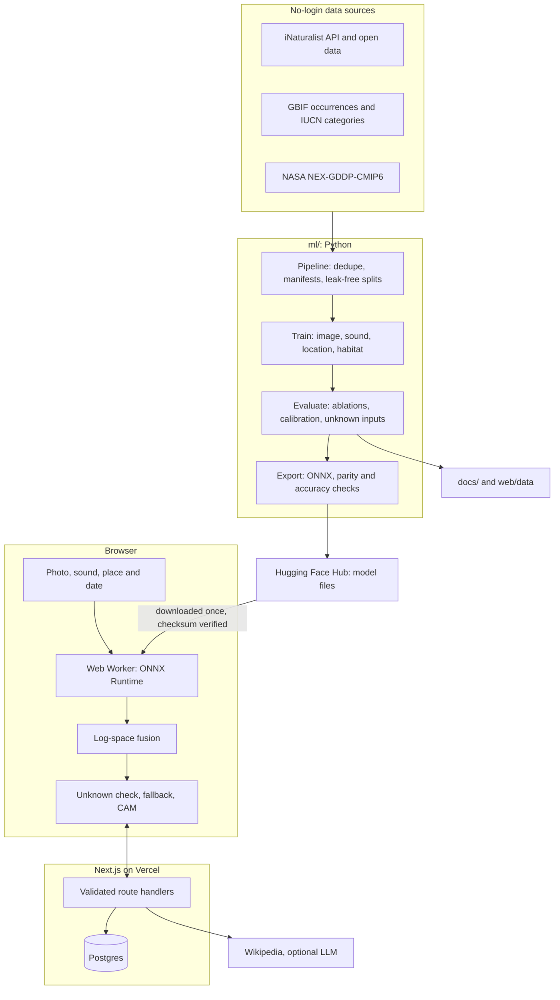

# WildLens

WildLens identifies Australian birds from photos and sound. It combines that evidence with where and
when the bird was seen, says so when it is unsure, and maps how each species' suitable climate may
shift. Identification runs entirely in the browser, so photos and recordings stay on the device.

This is a non-commercial portfolio project. Results are in the [evaluation report](docs/evaluation.md).

## Features

- **Photo and sound identification:** ONNX Runtime Web with WebGPU, falling back to WebAssembly.
- **Place and season:** A location model re-ranks species and explains what changed.
- **Honest uncertainty:** Calibrated confidence, an unfamiliar-input check and a fallback from species
  to genus, family or "I'm not sure".
- **Visual explanation:** A Class Activation Map shows which regions raised a species' score.
- **Climate futures:** Present and projected habitat under two emissions scenarios.
- **Camera trap batches:** Find animals, skip empty frames, review and export to CSV.
- **Grounded species profiles:** Every statement links to its source, and generation is optional.
- **Feedback loop:** Corrections feed a review queue, and a retrained model is only promoted if it
  does not regress on fixed test sets.

## Architecture



The final score for a species is:

```text
score(y) = log p(y | photo) + log p(y | sound) + weight * log max(p(y | place, day), floor)
```

Balanced training makes each classifier close to a likelihood, so adding a location prior does not
count that information twice. The floor stops the prior ruling out a genuine vagrant.

## Run it locally

You need Node 22 or newer. For the Python side you also need [uv](https://docs.astral.sh/uv/) and
ffmpeg.

```bash
# Website
cd web
npm ci
npm run dev
```

Identifying a bird needs model files in `web/public/models`. The training sequence below creates
them, or you can point `NEXT_PUBLIC_MODEL_BASE_URL` at a hosted copy.

```bash
# Tests
cd web && npm test && npm run build:e2e && npx playwright install chromium && npm run test:e2e
cd ml && uv sync --extra train --extra climate && uv run pytest
```

`uv sync` without those extras removes PyTorch from the environment. CI does that on purpose to stay
fast, and heavy tests then skip themselves.

## Reproduce the results

```bash
cd ml
uv run python data/build_dataset.py     # species, photos, occurrences, sounds (resumable)
uv run python data/prepare_audio.py     # decode recordings
uv run python data/build_climate.py     # climate grids
./run_training.sh                       # image, location and few-shot models with evaluation
uv run python training/train_sdm.py     # habitat models
./run_final.sh                          # sound model, reports and website data
```

This takes many hours on a laptop. Every step resumes after an interruption, and scripts can also run
on a free cloud GPU, because paths come from environment variables.

## Project layout

- `web/`: Next.js app, with route handlers, inference worker and tests
- `ml/`: Data pipeline, training, evaluation and export
- `docs/`: [Decisions](docs/decisions.md), [dataset card](docs/dataset_card.md),
  [model cards](docs/model_cards.md), [evaluation](docs/evaluation.md) and
  [deployment](docs/deployment.md)
- `data/`, `models/`: Local artefacts, not committed

## Limitations

- Only 550 species with enough photos are covered. Other birds get wrong names unless flagged as
  unfamiliar.
- Test data shares iNaturalist's biases, so real-world accuracy may be lower.
- Habitat maps use climate alone at about 25 km, and are projections with substantial uncertainty.
- Conservation status is the global IUCN category, not Australian listings.

Photos and recordings are by iNaturalist contributors, who are credited on the app's about page.
